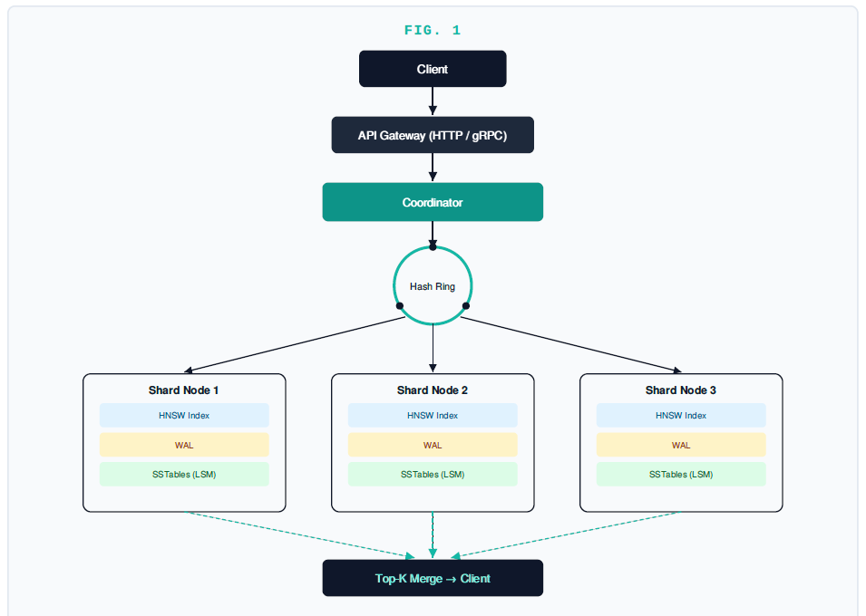

# VectorForge

**A distributed vector database built from scratch in Java.**

VectorForge implements approximate nearest-neighbor search using a custom HNSW index, distributed storage across three Java shard processes, and durable writes through a WAL-based storage engine.

## Features

- Custom Java HNSW index for approximate nearest-neighbor search
- Exact brute-force search for recall benchmarking
- Distributed architecture with 3 independent shard nodes
- Consistent hashing with virtual nodes
- Two-copy replication and quorum writes
- Write-Ahead Log (WAL) with recovery
- Memtable, SSTables, flushing, and compaction
- Parallel shard queries with global Top-K merging
- Browser-based embeddings using Transformers.js
- React dashboard for semantic search, document management, cluster monitoring, and benchmarking

## Architecture

## Tech Stack

| Component | Technology |
|---|---|
| Backend | Java |
| Frontend | React, JavaScript |
| Embeddings | Transformers.js, ONNX Runtime Web |
| Storage | WAL, Memtable, SSTables, Bloom Filters |
| Search | HNSW, Brute-Force Search |
| Distributed Systems | Consistent Hashing, Replication, Quorum Writes |
| Communication | HTTP/JSON |

## Benchmark (11,000 Documents)

| Metric | Result |
|---|---:|
| Exact search latency | 19.26 ms/query |
| Best Recall@K | 99% |
| Best observed speedup | 4.77× |
| Query sample | 20 |
| K | 5 |

Benchmarks compare HNSW against exact brute-force search across different `efSearch` values.

## Dashboard

- **Overview** — Cluster health, storage statistics, and shard metrics
- **Search** — Semantic search with configurable Top-K and `efSearch`
- **Documents** — Ingest, filter, delete, and export documents
- **Benchmark** — Compare recall and latency against exact search

---

Built to explore vector search, distributed systems, and storage engine internals.
